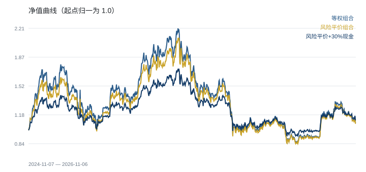

# 加密资产组合风险分析（Crypto Portfolio Risk Analyzer）

用 Python 标准库（无第三方依赖）对 5 个主流加密资产做风险指标计算与组合对比，输出 Markdown 报告与 SVG 图表。



## 结论摘要（2024-11-07 — 2026-11-06，730 个交易日）

| 组合 | 年化收益 | 年化波动 | 最大回撤 | Sharpe |
|---|---|---|---|---|
| 等权 | 4.31% | 56.63% | -61.68% | 0.36 |
| 风险平价（波动率倒数加权） | 3.83% | 53.22% | -59.99% | 0.34 |
| 风险平价 + 30% 现金 | 5.78% | 37.26% | -46.08% | 0.34 |

- 5 个标的日收益相关性在 0.55—0.83，分散化空间有限，风险平价只能小幅降波（-6.0%）。
- 留出 30% 现金后年化波动降到 37.26%、最大回撤从 -61.68% 收窄到 -46.08%；由于波动拖累下降，区间年化收益反而上升到 5.78%。

## 目录结构

```
fetch_data.py   抓取日频收盘价 -> data/*.csv（Binance 公共接口，无需 Key）
analyze.py      指标计算 + 组合回测 + 报告与图表 -> output/
data/           5 个标的的原始 CSV（date,close）
output/         report.md / metrics.csv / equity.svg / drawdown.svg
```

## 使用方法

```bash
python3 fetch_data.py     # 重新抓取行情（约 730 天）
python3 analyze.py        # 计算指标、生成报告与图表
open output/report.md
```

## 方法与口径

- **数据**：Binance `GET /api/v3/klines`，日频收盘价，USDT 计价，取所有标的日期交集。
- **年化收益**：`(期末/期初)^(365/交易日数) - 1`。
- **年化波动**：日收益标准差 × √365。
- **最大回撤**：历史峰值到谷值的最大跌幅。
- **Sharpe**：日收益均值 × 365 / 年化波动，无风险利率按 0 处理。
- **风险平价权重**：`w_i ∝ 1/σ_i`，按日再平衡；现金部分收益按 0 计。

## 局限

- 只有两年、5 个标的，样本内结论不代表长期有效。
- 未考虑手续费、滑点、借贷成本与资金费率。
- 相关性按全样本计算，未做滚动窗口稳定性检验。

## 可继续做的方向

1. 滚动 60 日相关性热力图，观察风险平价在相关性突变期的表现。
2. 加入手续费与再平衡频率敏感性分析。
3. 用历史模拟法（bootstrap）估组合 VaR 与 CVaR。
